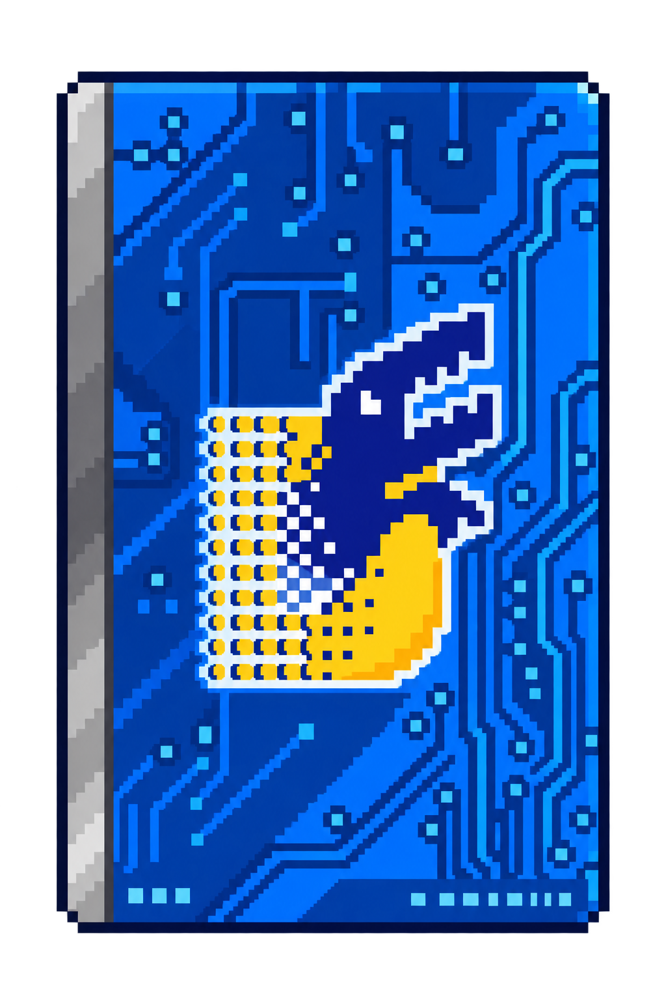
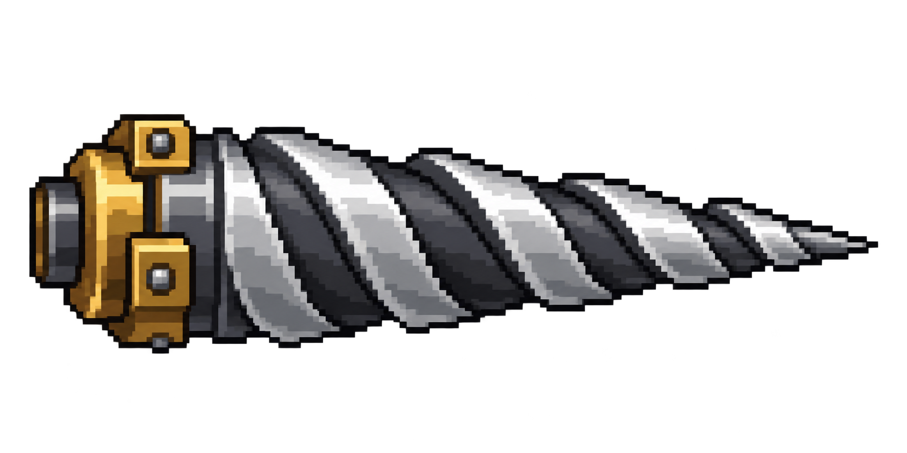

# 블루 카드와 강철 드릴 이미지 제작

내장 이미지 생성 도구를 사용했습니다. 기존 첨부 원본은 변경하지 않았습니다.

## 블루 카드

사용자가 첨부한 `블루카드.PNG`를 디자인 참고 이미지로 넣었습니다. 파란 회로무늬, 은색 왼쪽 테두리, 중앙의 남색·노란색 디지털 문양을 유지하고, 작은 인쇄 문구를 단순화한 레트로 도트 카드로 생성했습니다. 카드 바깥은 실제 알파 투명 배경입니다.



파일: `assets/v173c/blue_card.png`

## 강철 드릴

회전톱과 구분되도록 긴 원뿔형 실루엣, 오른쪽을 향한 뾰족한 끝, 대각선으로 감기는 은색 나선 홈을 지정했습니다. 카드의 기존 간이 도형 아이콘과 전투 중 드릴을 모두 이 이미지로 교체했습니다.



파일: `assets/v173c/steel_drill.png`

## 게임 적용

원본 PNG를 패치에 그대로 포함했습니다. 표시할 때 투명 여백을 제외한 영역을 사용하며, 유물 카드에서는 96×96 캔버스에 비율을 유지해 그립니다. 전투 드릴은 로딩 시 96×27 캔버스에 한 번 축소하여 재사용합니다. 드릴은 커서 방향으로 회전하며, 가로세로 비율을 유지하고 세로 폭만 약하게 주기적으로 변화시켜 회전감을 줍니다.

## 실제 생성 프롬프트

### 블루 카드 (첨부 이미지를 참고 이미지로 입력)

```text
Use case: style-transfer. Asset type: transparent-background retro pixel-art game relic icon. Input image 1 is the design reference: the blue Digimon card supplied by the user. Reinterpret this exact card as a clean chunky pixel-art collectible icon for a top-down action roguelike. Keep the upright portrait card silhouette, rich blue PCB circuit-pattern face, narrow silver-gray vertical strip on the left, and large central stylized dark navy digital D-shaped creature emblem with a gold/yellow pixelated lower-left swoosh and pale outline. Preserve the reference's recognizable layout and blue/gold palette. Simplify the tiny printed footer into a few quiet pixel markings; no new words, no mockup hands or scene. One card only, front view, centered, fully visible with generous transparent padding. A 64 by 96 logical pixel sprite enlarged with nearest-neighbor: large crisp square pixels, stepped one-to-two pixel dark outline, limited 12-color palette, two-to-three tone cel shading. No blur, no antialiasing, no soft glow, no drop shadow outside the card. True transparent background outside the card.
```

### 강철 드릴 (신규 생성)

```text
Use case: stylized-concept. Asset type: production pixel-art game weapon sprite with transparent background. Draw ONE conical steel AUGER DRILL BIT, side view, pointing horizontally RIGHT. A small rectangular brass-and-dark-steel mechanical mounting collar at the far LEFT, followed by a LONG tapered silver cone that narrows to a sharp tip on the RIGHT. Three to four broad diagonal silver helical flutes visibly wind around the long cone, alternating light steel ridges and deep dark grooves. Make the silhouette unmistakably an elongated piercing drill: cone length roughly three times its base diameter. Flat profile view, no circular saw, no toothed wheel, no saw blade, no radial starburst, no fan, no handle. Chunky retro 96x48 logical pixel art enlarged with nearest-neighbor; large square pixels, stepped dark outline, limited silver/charcoal/brass palette, two-to-three tone cel shading. Center the entire horizontal drill with generous EMPTY transparent padding on all sides. Only the isolated drill occupies pixels. Truly transparent RGBA outside its silhouette, no background color, no gradient backdrop, no floor, no cast shadow, no aura, no glow, no text. Readable at 80 to 120 pixels wide in a top-down action game.
```

